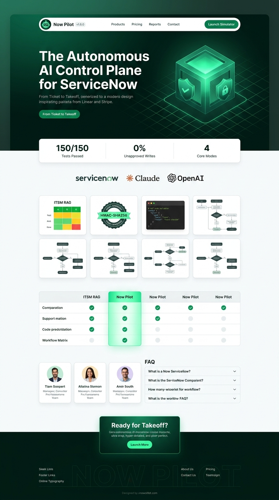
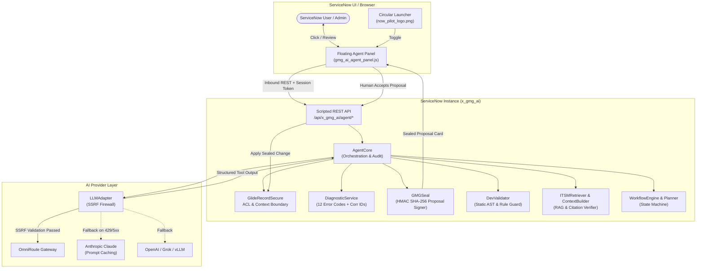

<div align="center">


# Now Pilot for ServiceNow

### *From Ticket to Takeoff.*

**The autonomous, controllable, and secure AI Agent built natively for the ServiceNow platform.**

[](https://github.com)
[](LICENSE)
[](src/test)
[](INSTALL.md)
[](src)
[](https://github.com)

<p align="center">
  <a href="#overview">Overview</a> •
  <a href="#does-it-actually-work">Does It Actually Work?</a> •
  <a href="#brand--the-logo">Brand & Logo</a> •
  <a href="#what-it-does">What It Does</a> •
  <a href="#architecture">Architecture</a> •
  <a href="#quick-start">Quick Start</a> •
  <a href="#security--governance">Security & Governance</a> •
  <a href="#provider-routing--budgets">Providers & Budgets</a> •
  <a href="#automated-test-suite">Tests</a> •
  <a href="CONTRIBUTING.md">Contributing</a> •
  <a href="SECURITY.md">Security</a> •
  <a href="LICENSE">License</a>
</p>

<p align="center">
  
</p>

</div>

---

> **Disclaimer:** Now Pilot for ServiceNow is an independent open-source project created by Kanam Ramu / GMG Technology LLC. It is not affiliated with, endorsed by, sponsored by, or maintained by ServiceNow, Inc., Anthropic PBC, OpenAI, Inc., or xAI Corp. ServiceNow, Now Platform, Next Experience, and Polaris are registered trademarks of ServiceNow, Inc. Anthropic and Claude are trademarks of Anthropic PBC. OpenAI is a trademark of OpenAI, Inc. This project has no affiliated cryptocurrency, token, or paid sponsorship program. Anything claiming otherwise is unauthorized.

---

## Overview

**Now Pilot for ServiceNow** is a full-featured, platform-native AI assistant designed specifically for enterprise ServiceNow environments. Operating directly within classic UI16 forms, lists, and Next Experience / Polaris iframes, Now Pilot bridges cutting-edge large language models with ServiceNow platform engineering:

- 🔒 **Zero Unapproved Writes**: The model never touches your database directly. All changes are generated as cryptographically sealed proposals (`GMGSeal`) requiring explicit human sign-off (**Accept / Reject**).
- 🛡️ **Platform-Native Authorization**: Every record read and search is strictly evaluated through `GlideRecordSecure`, ensuring the AI can only access data authorized for the logged-in user under ServiceNow Access Control Lists (ACLs).
- 🌐 **Multi-Provider & Gateway Freedom**: Connect seamlessly to **OmniRoute Gateway**, **Anthropic Claude** (with prompt caching), **OpenAI**, or any OpenAI-compatible API (Grok, Ollama, vLLM, LM Studio) with automated secondary fallback.
- 🔍 **ITSM Intelligence & RAG**: Explainable multi-factor incident similarity search, active published Knowledge Base retrieval, evidence-grounded recommendations, and citation verification with hallucination guards.
- 💻 **Development Assistant**: Generates, explains, reviews, and debugs Business Rules, Script Includes, Client Scripts, and UI Policies with static platform safety checks that catch dangerous calls (`current.update()`, `eval()`, prototype pollution).
- ⚡ **Agentic Workflow Automation**: Decomposes complex user goals into structured multi-step plans, executes permitted read tools, pauses safely for approval, and resumes with duplicate-write prevention.
- 🚀 **Zero-Dependency Local Simulator**: Test the entire frontend panel, REST endpoints, and mock incident context locally on your machine with `node local_runner.js` in under 60 seconds.

---

## Does It Actually Work?

Enterprise ServiceNow instances run mission-critical workflows: incident outages, customer requests, infrastructure assets, and platform scripts. Yet most enterprise AI offerings for ServiceNow fall into two extremes:

1. **Rigid, proprietary SaaS add-ons** with steep per-seat recurring fees, closed models, and little visibility into where your data travels.
2. **Naive chat wrappers** that execute unvetted code, hallucinate ticket numbers, or lack basic human-in-the-loop safeguards.

Now Pilot was engineered by ServiceNow platform architects and AI engineers to solve this real-world problem. 

We built Now Pilot to run **where you already work**: inside your ServiceNow browser session or in a local testing sandbox. It respects your existing platform roles, enforces strict execution deadlines and token spend limits, redacts credentials before logs are written, and rejects stale records if someone else modified them while the proposal was being generated.

Every capability in this repository is backed by real, deterministic code—not mocked marketing promises. **All 150 automated verification tests pass across our 5 test suites.**

---

## Brand & The Logo

<div align="center">
  <table>
    <tr>
      <td align="center" width="200">
        
      </td>
      <td>
        <b>Official Brand Asset</b>: <code>src/assets/now_pilot_logo.png</code><br/>
        <b>Dimensions</b>: 1024 &times; 972 transparent alpha PNG<br/>
        <b>Visual Identity</b>: The green Now Pilot robot symbol represents autonomous guidance, speed, and precision.<br/>
        <b>UI Launcher Button</b>: Renders as a <code>56px &times; 56px</code> circular button (<code>border-radius: 50%</code>) with a dark <code>#080808</code> background, a <code>#303030</code> border, and an accessible <code>#168B50</code> hover ring in the bottom-right corner of every ServiceNow form and list.
      </td>
    </tr>
  </table>
</div>

### Design Tokens & Color Palette
Now Pilot uses a refined dark-and-green visual system optimized for enterprise contrast and readability:

| Element | Color Hex | Role & Application |
| :--- | :--- | :--- |
| **Primary Accent** | `#168B50` | User message bubbles, primary buttons, active tab indicators, focus outlines |
| **Hover Green** | `#117342` | Primary button hover and interactive state |
| **Active Green** | `#0D5D35` | Button pressed / active state |
| **Dark Panel** | `#080808` | Panel background, header background, launcher button background |
| **Elevated Surface** | `#151515` | Message viewport, suggestion cards, proposal cards, textarea input |
| **Border** | `#303030` | Container boundaries, card dividers, mode switcher borders |
| **Main Text** | `#F5F5F5` | Headings, primary message copy, code snippets |
| **Secondary Text** | `#A3A3A3` | Subtitles, author attribution, cost chips, timestamps |

---

## What It Does

Now Pilot features four dedicated operational modes accessible via the top mode switcher:

```
┌────────────────────────────────────────────────────────────────────────┐
│ [ Chat ]   [ ITSM Intelligence ]   [ Dev Assistant ]   [ Workflows ]   │
└────────────────────────────────────────────────────────────────────────┘
```

### 1. 💬 Context-Aware Chat
- **Follows You Everywhere**: The floating panel rendered into the top-level window follows you seamlessly across forms, list views, and Next Experience iframe navigations.
- **Form Context**: Inspects current form table name, sys_id, and visible fields through `g_form` without sending unauthorized data.
- **Cross-User Isolation**: Browser session storage is scoped strictly to the authenticated `g_user.userID`. Switching user logins in the same tab immediately purges other users' state.

### 2. 🔍 ITSM Intelligence & RAG
- **Deterministic Incident Retrieval**: Ranks historical resolved incidents using explainable multi-factor scoring (text similarity + category/subcategory match + CI relationship) rather than black-box embeddings.
- **Knowledge Base Retrieval**: Queries active, published articles; strictly filters out draft, expired, or retired articles, respecting caller user criteria.
- **Grounded Recommendations**: Formats structured root-cause explanations and resolution summaries.
- **Citation Guard & Anti-Hallucination**: Automatically scans generated responses against the retrieved source registry. If the model cites an incident (e.g. `INC0010999`) that was not part of the retrieved evidence, Now Pilot displays an explicit red **Citation Warning** banner.

### 3. 💻 Dev Assistant & Static Validation
- **Artifact Generation**: Generates Business Rules (before, after, async), Script Includes (Class prototype & AbstractAjaxProcessor), Client Scripts (with `isLoading` guards), and UI Policies.
- **Static Validation Engine (`DevValidator`)**:
  - Enforces ServiceNow best practices: strictly blocks `current.update()` in Business Rules to prevent recursive platform freezes.
  - Flags dangerous JavaScript functions: `eval()`, `new Function()`, and dynamic string timeouts.
  - Sanitizes encoded queries to prevent injection vulnerabilities.
- **8-Point Architectural Review**: Analyzes existing scripts against platform execution context, performance bottlenecks, and security standards.

### 4. ⚡ Agentic Workflow Automation
- **Autonomous Multi-Step Planning (`WorkflowPlanner`)**: Accepts broad user goals (e.g., *"Investigate INC0010001, find matching resolved tickets, and propose a resolution note"*) and decomposes them into an ordered, executable JSON plan.
- **Controlled Tool Execution (`WorkflowEngine`)**:
  - Permitted read tools (`record_read`, `record_search`, `kb_search`, `code_read`) run automatically.
  - Write tools (`record_create`, `record_update`, `kb_create`) stage proposed changes as pending cards.
- **Safe Pause & Resume**: The workflow enters `waiting_approval` status until the user clicks **Accept**. If interrupted or reloaded, resume logic detects already-applied proposals and skips re-execution to prevent duplicate platform writes.

### 5. 🛡️ Cryptographic Proposal Integrity (`GMGSeal`)
- **HMAC SHA-256 Seal**: Proposals generated by the agent carry a cryptographic tamper seal. Any client-side parameter alteration invalidates the seal.
- **Stale Record Protection**: Before applying an approved proposal, the engine checks `sys_mod_count` and `sys_updated_on`. If another admin or user edited the record in the background, the transaction is rejected (`STALE_CONFLICT`).
- **Replay Protection**: Applying an already-applied proposal returns `HTTP 409 Conflict`.

---

## Architecture



---

## Quick Start

You can test Now Pilot in two ways: either immediately using the zero-dependency local simulator, or by deploying update sets to a ServiceNow sub-production instance.

### Option 1: Instant Local Sandbox (1 Minute)

No ServiceNow instance or external cloud accounts required. The repository includes an interactive local simulator replicating the ServiceNow client environment, incident forms, and agent endpoints:

1. **Clone the repository**:
   ```bash
   git clone https://github.com/your-username/servicenow-ai-agent.git
   cd servicenow-ai-agent
   ```
2. **Start the local runner**:
   ```bash
   node local_runner.js
   ```
3. **Open in your browser**:
   ```
   http://localhost:3000
   ```
4. Click the circular **Now Pilot** launcher button at the bottom-right corner to test Chat, ITSM, Dev Assistant, and Workflows against mock incident `INC0010001`!

---

### Option 2: Deploying to a ServiceNow Instance

#### System Requirements
- ServiceNow **Vancouver**, **Washington DC**, **Xanadu**, or **Australia** (Patch 7+).
- System Administrator privileges (`admin` role).
- Always install and test on a **sub-production (dev/test)** instance first.

#### Step 1: Import the Update Sets
Import the update sets in strict sequential order:

1. Go to **System Update Sets > Retrieved Update Sets**.
2. Select **Import Update Set from XML**.
3. Upload and commit the **Global Update Set** first:
   - File: `update_sets/gmg_ai_agent_global.xml`
   - Contains: Global UI Script `gmg_ai_agent_panel` and applier helper includes.
   - Click **Preview Update Set** &rarr; Verify 0 errors &rarr; Click **Commit Update Set**.
4. Upload and commit the **Scoped Update Set** second:
   - File: `update_sets/gmg_ai_agent_scoped.xml`
   - Contains: Scoped application `x_gmg_ai` (330 records, tables, ACLs, Script Includes, REST resources, settings).
   - Click **Preview Update Set** &rarr; Verify 0 errors &rarr; Click **Commit Update Set**.

#### Step 2: Assign User Roles
Assign the `x_gmg_ai.user` role to users who should have access to the agent launcher and chat panel:
- Users with `x_gmg_ai.user` can see the launcher and interact with the panel.
- Administrative settings and provider configurations require `admin`.

#### Step 3: Configure AI Providers
Navigate to **GMG AI Agent > Providers** and click **New**:
- **OmniRoute Gateway**:
  - Name: `OmniRoute Primary`
  - Type: `omniroute`
  - Base URL: `https://omniroute.internal.corp/v1`
  - Model: `omniroute/gpt-4o-mini` (or your preferred enterprise model)
  - API Key: Encrypted gateway secret key
- **Anthropic Claude**:
  - Name: `Anthropic Claude`
  - Type: `anthropic`
  - Model: `claude-3-5-sonnet-20241022`
  - API Key: Encrypted `sk-ant-...` key
- **OpenAI / OpenAI-Compatible**:
  - Name: `OpenAI Gateway`
  - Type: `openai_compatible`
  - Base URL: `https://api.openai.com/v1`
  - Model: `gpt-4o-mini`
  - API Key: Encrypted `sk-...` key

#### Step 4: Verify System Properties
Navigate to **GMG AI Agent > Settings** to review operational controls:
- `x_gmg_ai.fallback_providers`: Comma-separated list of secondary providers for automatic retry on rate limits (HTTP 429) or gateway errors.
- `x_gmg_ai.model_allowlist`: Optional comma-separated model identifiers allowed for user selection in the panel dropdown.
- `x_gmg_ai.allow_non_admin_writes`: Default `true`. Set to `false` to make the agent strictly read-only for non-admin users.
- `x_gmg_ai.allow_http_localhost`: Default `false`. Set to `true` only in local developer labs where gateways run on `127.0.0.1`.

---

## Security & Governance

Now Pilot is designed to meet strict enterprise information security standards:

```
┌────────────────────────────────────────────────────────────────────────┐
│                   NOW PILOT SECURITY ARCHITECTURE                      │
├────────────────────────────────────────────────────────────────────────┤
│ 1. Zero Unapproved Writes      All writes require explicit click       │
│ 2. SSRF Firewall               Blocks cloud metadata (169.254...)      │
│ 3. Platform ACLs               GlideRecordSecure enforced on all reads │
│ 4. Cryptographic Sealing       GMGSeal HMAC-SHA256 tamper detection    │
│ 5. Secret Redaction            Keys & passwords scrubbed from all logs │
│ 6. Observability               Authoritative correlation IDs (corr_*)  │
└────────────────────────────────────────────────────────────────────────┘
```

1. **SSRF Mitigation**: Outbound HTTP calls reject private subnets (RFC 1918), carrier-grade NAT, and cloud metadata services (`169.254.169.254`). Remote endpoints require HTTPS.
2. **Context Sandboxing**: Record text from tickets or Knowledge Base articles is tagged as untrusted input and sandboxed with strict boundary prompts to mitigate prompt injection.
3. **Audit Logging & Correlation IDs**: Every inbound request is assigned an authoritative server correlation ID (`corr_<timestamp>_<randomHex>`). Structured audit events are recorded in `x_gmg_ai_log` across all key state boundaries.
4. **Secret Scrubbing**: API keys, passwords, bearer tokens, and session credentials are systematically stripped before any diagnostic or log record is saved.

For full architectural details and vulnerability reporting protocols, see [SECURITY.md](SECURITY.md).

---

## Provider Routing & Budgets

Now Pilot provides enterprise cost controls and usage tracking:
- **Token Spend Tracking**: Displays exact costs in cents (`¢`) directly inside assistant response cards when prices per million tokens (`price_input_per_m`, `price_output_per_m`) are configured on the provider record.
- **Provider Budgets**: Enforces `daily_budget` and `monthly_budget` caps on individual providers.
- **User Spend Caps**: Set `x_gmg_ai.user_daily_cap_usd` to restrict daily per-user spend (set to `0` for unlimited).
- **Graceful Fallback**: If a primary provider encounters a rate limit (HTTP 429) or 5xx server error, Now Pilot automatically attempts the configured fallback provider within the remaining execution time budget. Non-retryable errors (e.g. HTTP 401 Auth Failure) fail immediately without exhausting budget.

---

## Automated Test Suite

Now Pilot includes a comprehensive automated test harness covering all major subsystems. All 150 tests execute without external network dependencies:

| Test Suite | File | Tests | Focus Area |
| :--- | :--- | :---: | :--- |
| **OmniRoute Integration** | `src/test/test_omniroute.js` | 13 | SSRF defense, model allowlist, fallback, token accounting |
| **Dev Assistant** | `src/test/test_dev_assistant.js` | 20 | Code generation, static AST validation, `current.update` guard |
| **ITSM Intelligence** | `src/test/test_itsm_intelligence.js` | 22 | Incident similarity, KB search, citation verification, prompt safety |
| **Workflow Automation** | `src/test/test_workflow_automation.js` | 22 | Goal planning, tool execution, pause/resume, lifecycle invariants |
| **Production Readiness** | `src/test/test_production_readiness.js` | 73 | Diagnostics, correlation IDs, secret redaction, update set integrity |
| **Total** | | **150** | **100% Pass Rate** |

### Run Tests Locally
```bash
# Run individual test suites
node src/test/test_omniroute.js
node src/test/test_dev_assistant.js
node src/test/test_itsm_intelligence.js
node src/test/test_workflow_automation.js
node src/test/test_production_readiness.js

# Or run the complete test suite at once:
node -e "['test_omniroute.js','test_dev_assistant.js','test_itsm_intelligence.js','test_workflow_automation.js','test_production_readiness.js'].forEach(f=>require('./src/test/'+f));"
```

---

## Project Structure

```
servicenow-ai-agent/
├── README.md                      # Complete project documentation
├── CONTRIBUTING.md                # Contribution guidelines and coding standards
├── SECURITY.md                    # Security policy, threat model & disclosure
├── INSTALL.md                     # ServiceNow installation guide & release notes
├── FEATURES.md                    # Detailed capability breakdown across versions
├── DATA_NOTICE.md                 # Privacy and network egress disclosure
├── TRADEMARKS.md                  # Trademark notices and brand attributions
├── LICENSE                        # Apache License 2.0 with copyright & author attribution
├── NOTICE                         # Formal Apache notice file
├── SHA256SUMS                     # SHA-256 verification hashes for XML update sets
├── local_runner.js                # Zero-dependency local testing environment (port 3000)
├── src/
│   ├── assets/
│   │   ├── now_pilot_logo.png     # Official high-resolution transparent logo
│   │   └── takeoff_logo.png       # Legacy logo asset (maintained for compatibility)
│   ├── global/
│   │   └── gmg_ai_agent_panel.js  # Global UI Script (UI16 & Next Experience launcher)
│   ├── scoped/                    # Scoped application Script Includes (x_gmg_ai)
│   │   ├── ActionService.js       # Proposal execution & record mutation handler
│   │   ├── AgentCore.js           # Multi-turn execution coordinator & auditor
│   │   ├── AgentTools.js          # Platform tool definitions & parameter bounds
│   │   ├── Budget.js              # Token accounting & spend cap tracker
│   │   ├── DevAssistant.js        # ServiceNow development assistant orchestrator
│   │   ├── DevValidator.js        # Static AST validator & platform safety rules
│   │   ├── DiagnosticService.js   # Centralized error classification & correlation IDs
│   │   ├── GMGSeal.js             # HMAC SHA-256 proposal tampering protection
│   │   ├── ITSMAssistant.js       # Grounded recommendation engine & summarizer
│   │   ├── ITSMContextBuilder.js  # Citation tracker & prompt boundary sandboxing
│   │   ├── ITSMRetriever.js       # Multi-factor similarity & active KB search
│   │   ├── LLMAdapter.js          # Gateway client, SSRF guard & provider fallback
│   │   ├── RecordTools.js         # Safe GlideRecordSecure access layer
│   │   ├── WorkflowEngine.js      # State machine & tool execution coordinator
│   │   ├── WorkflowPlanner.js     # Goal decomposition & step planner
│   │   └── rest_health.js         # Health check and diagnostic REST resource
│   └── test/                      # 150 automated verification tests
│       ├── test_dev_assistant.js
│       ├── test_itsm_intelligence.js
│       ├── test_omniroute.js
│       ├── test_production_readiness.js
│       └── test_workflow_automation.js
└── update_sets/
    ├── gmg_ai_agent_global.xml    # Global update set (3 updates, UI script + applier)
    └── gmg_ai_agent_scoped.xml    # Scoped application update set (330 updates)
```

---

## Contributing

We welcome community feedback, issue reports, and pull requests! Please read our [CONTRIBUTING.md](CONTRIBUTING.md) guide for our upstream merge criteria, development workflow, and update set synchronization process.

---

## License

This project is licensed under the **Apache License, Version 2.0**. See the [LICENSE](LICENSE) file for the full text.

```
Copyright 2026 GMG Technology LLC
Built by Kanam Ramu

Licensed under the Apache License, Version 2.0 (the "License");
you may not use this file except in compliance with the License.
You may obtain a copy of the License at

    http://www.apache.org/licenses/LICENSE-2.0
```

---

<div align="center">
  <b>Now Pilot for ServiceNow</b> &bull; Built by Kanam Ramu &bull; <i>From Ticket to Takeoff.</i>
</div>
